# Design: the Knowledge Engine Onboarding form

**Status: PROPOSAL for Gary's review. Nothing here is built, deployed or approved.** No code is in the pull request that carries this file; the first line of code is written only after Gary approves this design, and then as the separately reviewed pull requests in section 8.

**Author:** Claude Code (Core lane), at Gary's request, 2026-10-20 · **Rules in force:** `governance/AGENT_ROLES.md` v2.8 (v2.9 is proposed alongside this file) · **First instance:** TDAP · **Read with:** `governance/ENGINE_ONBOARDING.md` (the engine checklist this form implements), `governance/AGENT_ROLES.md` § Shared context contract.

People are named by role only in this file, because the file is public: the **advisor** (the TDAP research owner who has the final say), the **student** (the other TDAP research owner), and **Gary**.

---

## 0. In one page

**The problem.** TDAP's two research owners have open questions that Gary sent by email and that are still unanswered. Email is a poor instrument for this work: answers are scattered, nobody can see what the other owner said, there is no record of who decided what, and each reply costs Gary a manual merge into the engine's files. Every future engine will have the same need (`governance/ENGINE_ONBOARDING.md` §4 Phase 1 and Phase 2 are exactly "agree the questions, seeds and consent with the researcher").

**The proposal.** A reusable web form on www.copernicusai.fyi, signed in with the accounts that also let the owners make podcasts. Two research owners answer together, section by section, in a shared workspace. The advisor's "Mark final" makes a section final. Gary approves final sections in a review dashboard. **Nothing changes an engine until Gary approves.** Approved changes leave the system as a *change bundle* that Gary's agent turns into a pull request on the engine's repo, which Gary merges. The form never writes to GitHub, to `research_focus.json`, or to `research_papers`.

**The shape, in six decisions Gary has already made** (recorded here so the review can focus on what is new):

| Decision | Where it lands |
|---|---|
| Both owners are equal research owners; the advisor has final say through "Mark final" | §3.2 roles, §4 states |
| Two gates after drafting: final (advisor), then approved (Gary) | §4 |
| Invitation-based sign-up, matched to the existing allow-list; addresses never copied | §3.1, §5 |
| Podcasts private by default; per-episode "make public"; quota 10/month each, raisable by Gary | §7 (prerequisite PR) |
| A standing "suggest a paper" box after onboarding, reviewed the same way | §2.7, §8 PR 5 |
| The advisor is an anchor author for tdap-q1; the form offers his other relevant papers as candidate seeds | §2.4, §3.6 |

**What I recommend that Gary has not yet decided:**
1. **Approved changes reach the engine repo as an exported change bundle that Gary's agent turns into a pull request** (option ii in §6), not as a pull request opened by the web backend. The web backend then holds no write credential to any repository.
2. **Build the existing-features prerequisite first** (§7): owners must be able to open their own private episodes and publish them, and Gary must be able to raise a quota, before any owner is invited.
3. **Five separately reviewed pull requests plus one end-to-end test** (§8), roughly 15–19 working days of agent time, plus a small prerequisite PR 0 on the account-credential step (2–3 days, independent of this design), and a running cost under a dollar a month (§8.2).

**What I need from Gary:** the decisions in §10. The ones that change the design are Q1 to Q5.

---

## 1. What this design rests on (read-only inspection, 2026-10-20)

Every claim about current behaviour below cites a file and line in `copernicus-web` at `main` `9203b0ed8`, or a file in the public engine repo.

**The engine repo (`garywelz/tdap`, public).** Its files are the *current state* a bundle is diffed against: `docs/research_focus.json` (three provisional questions `tdap-q1..q3`, each with `q`, `terms`, `since`; `horizons`; `categories`; `mute`; empty `frontier` and `flagged`), `docs/seed_papers.md` (six confirmed tdap-q1/q2 seeds; four proposed tdap-q3 seeds; the reference-list source for each), `docs/hold_list.md` (66 candidate papers, in three groups: 25 moved after review, 10 background, 31 reachable only through the unconfirmed seeds; four are flagged "likely accept"), `docs/project_instructions.md` (the collaborator's own Claude instructions, which treat everything unpublished as private and say the repo is public), `AGENTS.md` (the repo is public; a collaborator proposes by pull request and never pushes to `main`; research questions change only with the collaborator's confirmation).

**The governance this must respect.**
- `governance/ENGINE_ONBOARDING.md`: §2 the hosted/federated arrangements (TDAP is hosted: Gary is PI, the collaborator owns the questions, Gary merges); §3 invariants a local layer may not loosen, including "nothing unpublished enters a public repo without that person's consent"; §4 the checklist this form operationalises (Phase 1 agreement, Phase 2 engine repo files, Phase 3 corpus); §5 "only Gary's agents touch Core infrastructure"; §5 "Departure" (what happens to a leaving PI's records) is explicitly undecided.
- `governance/AGENT_ROLES.md:156-163` (contract point 6): collaborators contribute "only through issues and pull requests on its public repo, which reach `main` through Gary's review"; `:164-166` (point 7): only Gary's agents touch Core infrastructure. The form is a third reviewed channel into the engine and has to be reconciled with both; v2.9 (§9) proposes the wording.
- Session rules 15 (gated deploys), 17 (security findings private first), 18 (a change to what the public can reach is gated like a Cloud Run deploy), 19 (merge only a PR Gary names), 20 (`--body-file`).

**The accounts and permissions that exist today.**
- A subscriber is a Firestore `subscribers` document whose ID is `sha256(email)` (`utils/subscriber_helpers.py:21-24`). The address is never needed as a key, which is what lets an invitation refer to an account without copying the address.
- The **allow-list** is the `can_generate` field on that document, with `monthly_quota` (`None` means unlimited), `generations_this_month` and `generation_month` (`utils/generation_quota.py:1-45`). Generation authorisation is `authorize_generation` (`utils/auth.py:126-165`): the admin key, or a subscriber with a valid session token, `can_generate=true`, and quota left (401 / 403 / 429). The check-and-increment is one Firestore transaction.
- Sessions: a random token returned once at login; only its sha256 and an expiry are stored on the subscriber document; compared in constant time; lifetime 14 days (`utils/subscriber_helpers.py:11, 60-90`). The client sends it as `X-Subscriber-Token`. The login page keeps the session in the browser's `localStorage` (`public/subscriber-dashboard.html:602-663`). The CORS policy is `allow_origins=["*"]` (`main.py:271-276`). Both matter for §9.
- Route guards: `require_admin_or_subscriber_owner` (path carries the subscriber ID) and `require_admin_or_podcast_owner` (the owner is resolved from the episode record) in `utils/auth.py:78-123`; the admin key is the `X-Admin-API-Key` header (`utils/auth.py:41-58`).
- Rate limiting: a Firestore-backed limiter keyed on the last forwarded address (`utils/rate_limit.py:1-40`), used for login (10 an hour) and the public question route (20 an hour).
- Mail: `email_service.py` sends through SMTP; it has completion and failure templates only.
- The existing pages are static HTML with Alpine under `public/` (`subscriber-dashboard.html`, `admin-dashboard.html`, `admin-subscribers.html`), served by the Vercel project that serves www.copernicusai.fyi. A merge to `main` is a production deploy (AGENTS.md; rule 18).
- **There is no admin control today to set `can_generate` or `monthly_quota`.** The quota is read in `subscriber-dashboard.html:214-230` but nothing in `endpoints/admin/routes.py` or the admin pages writes it. Gary's "raisable in the admin dashboard" therefore needs a route and a control (§7).

**Private episodes (access-control stages 1 and 2, 2026-10-15).**
- `utils/episode_access.py:1-22`: an episode is public only if it is in the feed (`submitted_to_rss`) or on the site (`visible_on_web`); every route answers 404 for anything else unless the request carries the admin key. The rule is admin-or-public; **an owner has no way to see their own private episode**.
- `media_store.py:1-15`: every generated media file is written to the **private** bucket; the episode record keeps its eventual public URLs; publishing calls `promote()` (copy private to public, verify MD5, CRC32C and size, fail closed); review uses short-lived V4 signed links, signed by the service account through the IAM API (`media_store.py:100-117`), at most 7 days.
- `endpoints/admin/routes.py:348-359` (`media-links`) and `:362-` (`publish-site`) are **admin-key only**.
- A new generation is `submitted_to_rss=False` (`services/podcast_generation_service.py:2637`), so "private by default" already holds for new episodes. An owner can already submit their own episode to the feed (`endpoints/subscriber/routes.py:511`, `require_admin_or_podcast_owner`).

**What I deliberately did not do.** I did not read the owners' email, and I did not look at any account document, address or quota value. Counts and field names above come from code and from the public engine repo only.

---

## 2. The template: what every engine's onboarding asks

One template, versioned (`template_version`), mirrors the engine contract the suite already uses (`ENGINE_ONBOARDING.md` §4, the A2 contract fields in `huggingface-space/scripts/acquire_papers/A2-standing-acquisition-contract.md`, and the shape of `docs/research_focus.json` and `docs/seed_papers.md`). An engine instance is the template plus engine-specific content loaded at build time (§2.8).

Every answer is an *item*: a small typed value plus an author, a time and a status (§4). Free-text fields have length caps (§9). Where the form asks the owners to choose, the choices are the ones Gary named.

### 2.1 Scope and use case
- A short statement of what the engine is for and who uses it (free text; shown on the engine's README after approval).
- "What would you want the podcast and the Knowledge Base UI to do for you?" (free text; informs the engine's use of the platform, not a repo file).
- Out of scope (list).
- **Output files affected:** `README.md` (scope paragraph) only, and only after approval.

### 2.2 Research questions
Per question, the owners choose **accept / reword / drop / split / add** and mark the question **central** or **background**:
- *accept*: keep as written. *reword*: propose new wording (the old wording is kept in the item history). *drop*: remove with a reason. *split*: replace one question with two or more (each new one gets its own wording and terms). *add*: a new question (id assigned by the system, `<engine>-qN`, next free number; ids are never reused, which keeps already-tagged papers meaningful).
- Per question, the **terms** (search vocabulary) as an editable list, with the same choices per term.
- **Central vs background** is a new field. It does not exist in `research_focus.json` today; a bundle proposes it as an additive field the acquisition code ignores until Core uses it (§6.4). The owners should be told this plainly in the form.
- Output files: `docs/research_focus.json` (`active_questions`).

### 2.3 Keywords and horizons
- `categories` (arXiv-style subject classes), `horizons` (a list of one-line frontier topics), `mute` (topics to keep out) and `frontier` / `flagged` (empty for TDAP today). Each entry: keep / reword / drop / add.
- Output files: `docs/research_focus.json`.

### 2.4 Seed papers
- **Confirm:** each current seed shows its full citation and identifier with yes / no / unsure and a comment.
- **Add** by DOI, arXiv id, PubMed id or title. The server resolves the identifier (§5.5) and shows the registry's own title, authors, year and abstract so the owner confirms the *right* paper. This is the lesson in `ENGINE_ONBOARDING.md` §6 ("relay full titles and identifiers, not author names"): the form never accepts an author name as a seed.
- Per seed, the question(s) it belongs to (`tdap-q1`, ...). Seeds are never auto-promoted into `research_focus.json`; the seed set stays a separate, deliberate step (the existing design in `researcher_cited_intake.py`).
- **Anchor authors.** For an owner who is an anchor author of a question (the advisor, for tdap-q1), the form offers that author's other relevant works as *candidate seeds*, found through an OpenAlex author lookup (§3.6). Candidates are suggestions only: nothing is a seed until the owner confirms it item by item.
- Output files: `docs/seed_papers.md` and a seed CSV (`doi,question_ids[,title,arxiv_id,admit_policy]`, the format `citation_expansion_pilot.py --seed-doi-file` already reads).

### 2.5 Optional engine-specific review queue
- A list of candidate papers an engine wants judged (TDAP's hold list). Per paper: **keep / drop / unsure**, a comment, the abstract displayed, filters (by group, by flag, by unresolved), bulk marking of a filtered selection, and a "flagged by reviewer as likely keep" marker.
- Optional: an engine that has no such list skips the section.
- Output files: `docs/hold_list.md` (decisions recorded) and, for *keep* decisions, a request for Core to ingest them (a post-merge Core task, §6.4); the form does not ingest.

### 2.6 Bibliography upload, with a "not yet public" flag
- The owners may upload their own bibliography: **BibTeX, RIS, a list of DOIs, or pasted text**. The server parses it into entries and resolves identifiers where it can.
- Every entry carries `not_yet_public`, **default true**. An entry that is not yet public stays in a private store: it is never written to a public repository, never shown to the other engine's people, never ingested into `research_papers`, and never leaves the system in a bundle. Only an entry the owner has explicitly marked as published (and for which the server can resolve a public identifier) can become a seed candidate.
- This implements invariant 6 of `ENGINE_ONBOARDING.md` §3 mechanically rather than by instruction. It is also the safeguard against the failure `docs/project_instructions.md` §6 warns about (unpublished work in a public repo).
- Output files: none by default. A published entry that the owners propose as a seed flows through §2.4.

### 2.7 The standing "suggest a paper" box
After onboarding, a permanent form on the engine's page: identifier (or title), the question it bears on, and a sentence of why. A suggestion goes through the same lookup, the same draft / final / approved path (§4) and the same bundle (§6). Suggestions are batched, so Gary reviews a short list rather than a stream. See §8 PR 5.

### 2.8 Attribution and privacy consent
Asked once per person, before any other section accepts input:
- **How may you be named in the public repository?** By role only, by name only, by name and role, or not at all. Default: **by role only.** This governs every file in a bundle.
- **Contact details:** the form states that no email address is ever written to a public file. This is not a choice.
- **Licence:** the engine repo's licence is currently CC0, mirrored from ATAP and GLMP as a default and not confirmed with the collaborator (`tdap/README.md`, Open items). The form asks the owners to confirm the licence or name another.
- **Consent for third-party lookups:** that titles, identifiers and (for the author lookup) the owner's name are sent to public scholarly APIs (§5.5).
- **Departure.** `ENGINE_ONBOARDING.md` §5 leaves open whether a departing PI receives a copy of their records. The form displays Gary's decision here once he makes one (Q9).
- A person's consent record is itself a versioned, audited item (§4).

### 2.9 Engine-specific content, loaded at build time
The template is generic. An engine's own content (its questions, terms, seeds, hold list) is **read from the engine repo at a pinned commit by a loader script and written to Firestore**; it is never copied into this public document or into the form's source. For TDAP the loader reads `docs/research_focus.json`, `docs/seed_papers.md` and `docs/hold_list.md` at a named commit and creates:
- the three provisional questions (with their terms), the horizons, categories and mute list;
- the six confirmed seeds and the four proposed tdap-q3 seeds (each yes / no / unsure with a comment, so the second group is the owners' decision rather than a fact);
- the 66-paper hold list in its three groups, with the four flagged "likely accept" marked, and each entry's abstract fetched from the scholarly registries and stored privately.

The loader records the commit it read, so a later bundle is diffed against exactly that base (§6.3) and a changed `main` is detected rather than overwritten.

---

## 3. People, accounts and roles

### 3.1 Accounts and invitations
- The owners are **existing subscribers**: their allow-list entries (`can_generate`) are already in Firestore and are never copied. An *invitation* refers to a subscriber by `subscriber_id` (the `sha256(email)` document ID), the engine, and a role. The invitation email is sent from the address stored on the subscriber document at send time; the address is never written to the invitation or to a log line.
- Gary creates an invitation in the admin dashboard for a subscriber who is on the allow-list. The server **refuses to invite a subscriber who is not allow-listed** (the matching rule Gary asked for).
- The invitation is a random token, emailed as a link to a page on www.copernicusai.fyi. Only the token's sha256 is stored, with an expiry (7 days), a single use, and the engine and role. The recipient opens the link, accepts the consent step (§2.8), and sets or confirms their credentials through the account-credential flow of PR 0 (§8). Acceptance creates an *engine membership* (§3.2) and is audited.
- No other route creates an account that can reach an onboarding engine.

### 3.2 Roles
| Role | Who | Can |
|---|---|---|
| `owner` | each research owner (student, advisor) | read and edit every section of their engine's onboarding; comment; mark items; upload to their own private bibliography; suggest papers |
| `final_say` | exactly one owner per engine (the advisor), a flag on a membership, not a separate account type | everything an `owner` can, plus **Mark final** on a section |
| admin | Gary, through the existing admin key | invite, approve/reject, export bundles, raise quotas; **never an edit of an owner's answers** |

Equal ownership means both owners can edit anything; the only asymmetry is "Mark final". An engine has one `final_say` member at a time; changing it is an admin action recorded in the audit log.

### 3.3 What an owner cannot do
Read another engine's onboarding, read the other owner's private bibliography, approve their own section, change the state of a section Gary has approved (a change after approval opens a new draft revision, §4), reach any route as an unauthenticated caller, or write anywhere outside the `onboarding_*` collections.

### 3.4 Accounts that also make podcasts
The same account, the same session, the same quota. The two features are separate in the data (onboarding documents never live on the subscriber document) and share only the identity and the session.

### 3.5 Sessions
The existing session token is used as is: `X-Subscriber-Token`, a 14-day lifetime, hashed at rest. Two points are raised for Gary in §9/§10 (storage of the token in the browser; one session per account at a time).

### 3.6 The anchor-author lookup
For a `final_say` or `owner` member who is an anchor author of a question, the form offers: "Find your works". Steps: the owner enters their name and, optionally, an ORCID or institution; the server asks OpenAlex for author candidates; the owner picks the right author record (disambiguation is theirs, not the system's); the server fetches that author's works, scores them against the engine's question terms, and shows the top candidates with the registry title, venue, year and abstract. The owner marks each *seed for tdap-q1 / not a seed / not mine*. Nothing is stored about the author beyond the chosen OpenAlex id, and the name is never written to a bundle unless the owner's naming choice (§2.8) allows it.

---

## 4. Collaboration and the two gates

### 4.1 Shared state
One workspace per engine. Both owners see the same items live (a short polling refresh, not websockets: Cloud Run request-based billing and cold starts argue against a long-lived connection). Every save is an **autosave**: debounced, a single item at a time, with the author and a server timestamp recorded per answer. Two owners editing the same item is resolved by **optimistic concurrency**: a save carries the item revision it was based on; a stale save is refused with the current value and a one-click merge, never silently overwritten.

### 4.2 Per-answer provenance
Each answer shows *who* last changed it and *when*, and the item history (a list of revisions with author and time) is one click away. The history is how the second owner sees what the first one changed.

### 4.3 Comment threads
A thread per item, plain text only, with author and time; a thread can be resolved by either owner. Gary can read threads in the review dashboard and comment on a section; his comments are labelled as admin.

### 4.4 Progress tracker
A summary on the engine page: per section, the number of items open / answered / disagreed (two owners gave different values) / final / approved; a "what is left" list; and a visible "waiting on" line (the other owner, the advisor, or Gary).

### 4.5 The state machine

```mermaid
stateDiagram-v2
    [*] --> draft
    draft --> final: Mark final (final_say owner only)
    final --> draft: any edit by any owner (re-opens; recorded)
    final --> approved: Gary approves
    final --> rejected: Gary rejects with a note
    rejected --> draft: owners revise
    approved --> draft: any later edit starts a new revision
    approved --> [*]
```

- **draft.** Both owners edit freely.
- **final.** Set by the `final_say` owner on a *section*. A final section is read-only until it is re-opened; **any edit by any owner re-opens it to draft** and notifies the `final_say` owner, because a section must not stay "final" with content the advisor has not seen.
- **approved.** Set by Gary. Approval is of a specific section revision and its content hash; an approved section is frozen. A later edit creates a new revision in draft; the old approved revision remains in the history and in any bundle already exported.
- **rejected.** Gary's note is shown to the owners; the section returns to draft.
- Gary cannot edit an owner's answer. He can only approve, reject, comment, or export.
- Nothing reaches the repo from a section that is not `approved`.

### 4.6 Notifications
Email to the `final_say` owner when a section becomes ready (every item answered and no open disagreement) or is re-opened; to the owners when Gary approves or rejects. Email only, through the existing SMTP service, with a link and no content in the message. An owner can switch these off for themselves.

---

## 5. Gary's review dashboard, API, pages and data

### 5.1 Review dashboard
A new admin page beside the existing ones (`public/admin-dashboard.html`, `public/admin-subscribers.html`), using the admin key the same way they do. It shows:
- every engine and section with its state, the people it is waiting on, and its age;
- for a `final` section, a **diff of proposed against current**: the proposed content of each output file against the file as it is on `main` of the engine repo *now* (fetched by plain HTTPS from the public repo; no token), with the base commit shown;
- the owners' per-item history and the comment threads;
- **approve / reject with a note**;
- **create bundle** (select approved sections), **download bundle**, and **mark bundle merged** (paste the PR URL).
- an **invitations** panel and a **quota** panel (§7).

### 5.2 Approved changes reach the engine: the two options compared (item d)
Both start from the same place: Gary has approved sections, and a bundle of proposed file changes exists.

**Option (i): the backend opens the pull request with a GitHub token.**
- *For:* fewer steps; the PR appears the moment Gary approves.
- *Against:* it puts a **GitHub credential with write access to a public repository in the web backend**, the internet-facing service that is also where every other subscriber route lives. Anything that reaches that credential (a bug in an unrelated route, a leaked log, a dependency compromise) can push content to a public repo under Gary's or a bot's name. A fine-grained token can be scoped to one repo and to `contents` and `pull_requests` write, but it still lets an attacker open PRs containing arbitrary text that reads as the project's own words, and it adds a secret to rotate, to store (Secret Manager), and to put through the credential rule. It also puts a third party's write path in the hands of a service that today holds no repository credentials at all. It is hard to square with the floor ("propose before executing") and with the principle in `AGENT_ROLES.md:164-166` that collaborators' input reaches Core only as a request Gary's agents carry out.
- The PR it opens is also *less* reviewed than the form: the diff Gary approved is the diff the backend builds, so nothing checks it again between approval and PR.

**Option (ii): the dashboard exports an approved change bundle; Gary's agent turns it into a PR.**
- *For:* **no write credential for any repository exists in the web backend.** The only write the form can do is to its own Firestore collections and a private bucket. The agent that opens the PR is the one that already holds Gary's authority, runs under the session rules, and works from a fresh clone of the engine repo. It *re-verifies* the bundle against the repo before opening the PR (§5.3): the base commit is still the tip, the base blob hashes match, the proposed content passes the public-safety checks, the files parse. The bundle is therefore reviewed three times (the owners, Gary in the dashboard, the agent's re-check), and Gary merges.
- *Against:* one manual hand-off per bundle. A bundle is small and the volume is low (a few per engine over its onboarding, then occasional suggestion batches), so the cost is a few minutes.

**Recommendation: (ii).** It matches Gary's stated starting view, keeps the credential surface unchanged, and gives a natural place for a final automated check. If volume ever justifies automation, the safe upgrade is for the *agent* to poll for approved bundles; the credential still never enters the web backend.

### 5.3 The change bundle
A single JSON document, `engine_onboarding_bundle` v1, stored in the private bucket and downloadable by Gary:

```text
bundle_id, engine_id, template_version, created_at, created_by: "gary"
base:      { repo, branch: "main", commit_sha }          # the commit the proposed files were diffed against
sections:  [ { section, revision, content_sha256,
               final_by_role, final_at, approved_at, approver_note } ]
files:     [ { path, action: "modify" | "add",
               base_blob_sha, proposed_sha256, proposed_content } ]
core_tasks:[ { kind: "ingest_seed" | "ingest_keep" | "retag" | "scope_change",
               payload } ]                                # what Gary's Core agent does AFTER the PR merges
checks:    { public_safe: true|false, no_email: true|false,
             no_not_yet_public: true|false, schema_ok: true|false }
pr_text:   { title, body }                               # draft text, no names beyond the consent choice
```
The agent's checks, which must all pass before it opens a PR: the base commit is still the repo tip (or the diff is regenerated and shown); every `base_blob_sha` matches; every `proposed_sha256` matches its content; `research_focus.json` parses and has the A2 fields; no email-shaped string, no `not_yet_public` entry and no name outside the consent choice appears in any proposed file.

### 5.4 Post-merge Core tasks (not done by the form)
Approved seeds and *keep* decisions need Core work the form must not do: seed intake (`researcher_cited_intake.py`), citation expansion (`citation_expansion_pilot.py --seed-doi-file`, dry run, review, then `--write`), embedding, and a `config/engine_registry.py` update if a question id is added or retired. Each is listed in the bundle's `core_tasks`, and Gary's agents run them in the gated way `ENGINE_ONBOARDING.md` §4 Phase 3 already prescribes. The form never writes `research_papers`.

### 5.5 Third-party lookups
The server, not the browser, calls Crossref, OpenAlex, arXiv and Semantic Scholar (the same sources the intake scripts use), with a short cache, a per-user rate limit, a response-size cap and a timeout. Results are *suggestions with provenance*: the registry's record is shown beside the owner's input. An empty result is reported as "not found", never as "no such paper" (the lesson in `ENGINE_ONBOARDING.md` §6: external sources rate-limit; an empty result is an instrument question first).

### 5.6 Data model (Firestore; all collections prefixed `onboarding_`)
Written only by the service. No collection holds a raw email address.

| Collection · key | Fields | Notes |
|---|---|---|
| `onboarding_engines` · `engine_id` | `label`, `full_name`, `template_version`, `state` (`open`, `suggest_only`, `closed`), `source` {repo, commit_sha, loaded_at}, `final_say_subscriber_id`, `question_id_prefix`, `created_at` | one per engine instance |
| `onboarding_members` · `engine_id__subscriber_id` | `role` (`owner`), `final_say` (bool), `consent` {naming, licence, lookups, version, at}, `joined_at`, `status` | membership; the account stays a normal subscriber |
| `onboarding_invites` · `invite_id` | `engine_id`, `subscriber_id`, `role`, `final_say`, `token_hash`, `expires_at`, `used_at`, `created_by`, `created_at` | single use; token never stored |
| `onboarding_sections` · `engine_id__section` | `status` (`draft`, `final`, `approved`, `rejected`), `revision`, `content_sha256`, `final_by`, `final_at`, `approved_at`, `approver_note`, `reopened_by`, `updated_at` | the gate state |
| `onboarding_items` · `engine_id__section__item_id` | `type`, `value`, `revision`, `author_subscriber_id`, `updated_at`, `choice`, `comment_count`, `history` (capped list of {revision, value_sha256, author, at}) | one answer; full prior values in the audit log |
| `onboarding_comments` · `comment_id` | `engine_id`, `item_id`, `thread_id`, `author_subscriber_id`, `author_role`, `body`, `created_at`, `resolved` | plain text |
| `onboarding_biblio` · `entry_id` | `engine_id`, `owner_subscriber_id`, `source_format`, `raw_ref` (size-capped), `resolved_id`, `not_yet_public` (default true), `published_ok`, `created_at` | **owner-private**; never read by another member |
| `onboarding_candidates` · `candidate_id` | `engine_id`, `origin` (`hold_list`, `author_lookup`, `suggestion`), `identifier`, `registry_record`, `abstract`, `decision` (`keep`, `drop`, `unsure`), `question_ids`, `flags` | seeds and the review queue |
| `onboarding_bundles` · `bundle_id` | `engine_id`, `status` (`created`, `exported`, `pr_opened`, `merged`, `superseded`), `base_commit_sha`, `bundle_sha256`, `object_path`, `pr_url`, `created_at` | the JSON itself lives in the private bucket |
| `onboarding_events` · `event_id` | `ts`, `engine_id`, `actor_subscriber_id` or `admin`, `actor_role`, `action`, `target`, `before_sha256`, `after_sha256`, `ip_hash`, `request_id` | **append-only audit log**; no update or delete route exists |

State changes (`final`, `approve`, `reject`, `reopen`, `invite`, `accept`, `export`, `role change`, `consent`) each write an event in the same transaction as the change, so there is no change without a record. The audit log keeps full prior values (the item document keeps only a capped history).

### 5.7 API routes and access control
All routes live under `/api/onboarding/` on the existing service and are **default deny**: a shared dependency resolves the caller to an engine membership or to admin before any handler runs. A caller who is not a member of the engine receives **404**, never 403, for any engine route (the same rule `episode_access.py` uses, so a guesser learns nothing).

| Route | Who | Does |
|---|---|---|
| `POST /api/onboarding/invites/accept` | holder of a valid token | consume the token, record consent, create the membership |
| `GET /api/onboarding/engines/{e}` | member, admin | engine, sections, progress, who is waiting |
| `GET /api/onboarding/engines/{e}/sections/{s}` | member, admin | items, comments, provenance |
| `PUT /api/onboarding/engines/{e}/items/{i}` | member (not on a `final` or `approved` section: edit re-opens, see §4.5) | autosave one answer with `base_revision` |
| `POST /api/onboarding/engines/{e}/items/{i}/comments` | member, admin | add a comment |
| `POST /api/onboarding/engines/{e}/sections/{s}/final` | **`final_say` member only** | Mark final |
| `POST /api/onboarding/engines/{e}/lookup` | member | resolve an identifier or title (rate-limited, cached) |
| `POST /api/onboarding/engines/{e}/author-lookup` · `GET .../author-lookup/{job}` | member | the anchor-author candidate flow (§3.6) |
| `POST /api/onboarding/engines/{e}/biblio` · `GET/DELETE .../biblio/{id}` | the owning member only | upload, list and delete one's own private entries |
| `POST /api/onboarding/engines/{e}/suggestions` | member | suggest a paper |
| `GET /api/admin/onboarding/engines` · `.../engines/{e}/diff` | admin | dashboard data and the proposed-vs-current diff |
| `POST /api/admin/onboarding/engines/{e}/sections/{s}/approve` · `/reject` | admin | approve or reject a `final` section, with a note |
| `POST /api/admin/onboarding/invites` · `DELETE .../{id}` | admin | create or revoke an invitation (allow-listed subscribers only) |
| `POST /api/admin/onboarding/engines/{e}/bundles` · `GET .../bundles/{b}` · `POST .../bundles/{b}/merged` | admin | create, download and close a bundle |
| `PUT /api/admin/subscribers/{id}/quota` | admin | raise or lower `monthly_quota` (§7) |

### 5.8 Pages
All under `public/onboarding/` as static pages with Alpine, in the style of the existing subscriber pages, so no new framework or build step: `accept.html` (invitation and consent), `engine.html` (progress and section list), `section.html` (the item editor), `candidates.html` (seed lookup and the review queue), `biblio.html` (private uploads), `suggest.html` (the standing box), and `public/admin-onboarding.html` (Gary's dashboard, with the invitation, bundle and quota panels). None is linked from a public page, none is indexed (`noindex`), and each loads nothing that can be written by a user as HTML: items are displayed with `x-text`, never `x-html`.

---

## 6. The bundle's route into the repo, end to end

1. Owners answer; the advisor marks sections final.
2. Gary reviews each final section's diff in the dashboard and approves or rejects.
3. Gary selects approved sections and clicks **create bundle**: the server renders the proposed files from the *approved revisions only*, diffs them against the repo's current `main`, runs the public-safety checks, and stores the bundle.
4. Gary downloads the bundle (or points his agent at it) and the agent opens a PR on the engine repo, after the checks in §5.3. Gary merges. (A merge of the engine repo is not a production deploy; a merge to `copernicus-web` `main` is.)
5. Gary's agents run the listed Core tasks (§5.4) in their gated way.
6. Gary pastes the PR URL into the dashboard; the bundle becomes `merged`, and the owners see it.

### 6.1 What the form can and cannot touch
It can write `onboarding_*` Firestore documents and objects in a private bucket prefix. It cannot write to GitHub, to the engine's `research_focus.json`, to `research_papers`, to the public bucket, or to the subscribers' episode records.

### 6.2 Where each output lands
| Section | Output file in the engine repo | Core task after merge |
|---|---|---|
| Scope and use case | `README.md` scope paragraph | none |
| Research questions | `docs/research_focus.json` (`active_questions`) | update `config/engine_registry.py` tags and the status job's question ids if an id was added or retired |
| Keywords and horizons | `docs/research_focus.json` | none |
| Seed papers | `docs/seed_papers.md`, `docs/seed_papers.csv` | seed intake, then gated expansion, then embedding |
| Review queue | `docs/hold_list.md` | ingest the *keep* set |
| Bibliography | none (private) | none unless an entry is separately proposed as a seed |
| Consent | `README.md` attribution line, per the owners' choice | none |

### 6.3 Stale base
If `main` of the engine repo moved after the bundle was created, the agent regenerates the diff against the new tip and shows Gary the difference before opening the PR; if a proposed file's base blob changed, the bundle is marked `superseded` and re-created.

### 6.4 A field the engine does not have yet
"Central vs background" has no field in `research_focus.json` today. A bundle adds it as an optional `priority` on each question. Nothing in the acquisition code reads it, and no existing reader breaks (they read `q`, `terms`, `since`, per the A2 contract); Core decides separately if and how scouts use it.

---

## 7. Prerequisite: private-episode access, per-episode publish, quota

Owners must be able to hear what they make, and Gary must be able to give them room to make it, before anyone is invited. This is its own pull request (§8 PR 1) and is useful on its own to every subscriber.

### 7.1 Opening your own private episodes
- **New route:** `GET /api/subscribers/episodes/{episode_id}/media-links?minutes=N` guarded by the existing `require_admin_or_podcast_owner` (`utils/auth.py:101-123`), which resolves the owning subscriber from the episode record and verifies the caller's session token. It returns `media_store.signed_links(...)` for that one episode (`media_store.py`), with a **short lifetime: default 15 minutes, hard maximum 60**, against the admin route's up to 7 days (`endpoints/admin/routes.py:348-359`).
- **New view rule:** `utils/episode_access.py` gets an `owner_ok(record, subscriber_id)` beside `admin_key_ok`, and `can_view` takes an optional authenticated owner; an unauthenticated or non-owner caller still gets 404.
- **"Bound to the session", stated honestly.** A V4 signed link is a *bearer* link: anyone who holds it can fetch the file until it expires. It cannot be cryptographically tied to a session. The binding available is: the link is minted only for a request carrying a valid owner session, the lifetime is minutes, and the page mints a fresh link each time the owner presses play. The alternative that really binds each byte to a session is to **stream the file through the backend** (`GET /api/subscribers/episodes/{id}/audio` with HTTP Range support). It costs Cloud Run request time and bandwidth for every play and makes cold starts audible. **Recommendation: short-lived signed links** for audio and images, the existing pattern, and streaming left as an upgrade if Gary wants it (Q2).
- The owner's episode *list* already exists (`endpoints/subscriber/routes.py:320`); it needs to mark each episode private or public, which the record already knows.

### 7.2 Per-episode "make public"
- **New route:** `POST /api/subscribers/episodes/{episode_id}/make-public`, the same guard. It calls `media_store.promote` (copy private to public, verify MD5/CRC32C/size, fail closed) and then sets `visible_on_web`, exactly the sequence of the admin `publish-site` route (`endpoints/admin/routes.py:362-`), with the same rollback (`demote`) if the record write fails. It does **not** submit the episode to the podcast feed: that is the separate, existing action `submit-to-rss` (`endpoints/subscriber/routes.py:511`), which pushes the episode out to Spotify, Apple Podcasts and YouTube.
- **It is effectively one-way.** Once files are public they can be cached or copied. The page says so before the owner confirms. Whether an owner can *unpublish* is Gary's call (Q1); the safe default is that only Gary can.
- Per rule 18 this is a change to what the public can reach: the route, and the page that calls it, each ship gated, with a test episode, before they serve real owners.

### 7.3 Quota: 10 a month each, raisable by Gary
- The mechanism already exists and is atomic (`utils/generation_quota.py`): `monthly_quota` on the subscriber document. Setting the two owners to 10 is a data change, made by Gary's agent at invitation time, not code.
- **Missing: any admin way to change it** (§1). New route `PUT /api/admin/subscribers/{subscriber_id}/quota` (admin key; integer 0..200 or `null` for unlimited; audited) and a control on `public/admin-subscribers.html`.
- Two behaviours to decide in review, not assume: whether a *failed* generation consumes quota, and what the owner sees at 429 (Q6).

---

## 8. Build plan

Each item is a separate pull request, reviewed and gated on its own (rules 15, 18, 19, 20). Each ships dark: new routes answer 404 for anyone who is not on an explicit allow-list until the next PR is ready, controlled by a Firestore configuration document, not an environment variable (DEPLOY.md forbids passing environment variables at deploy time). Backend deploys follow `cloud-run-backend/DEPLOY.md`: build from a clean checkout, deploy by digest with `--no-traffic`, diff the revision specs, smoke-test, and move traffic only when Gary approves. A merge of the static pages to `copernicus-web` `main` is a production deploy of the public site and is treated as publishing.

### 8.1 The sequence

**PR 0 · Account-credential prerequisites.** The credential step that invitation acceptance depends on: single-use, expiring tokens for setting a password, reused for any later credential change. Any further scope is held in the private security record (rule 17); this document deliberately says no more. *It must land before PR 2; it is independent of the rest and should not wait for this design's approval.* · Effort: 2–3 days. · Test: unit tests for token issue, single use, expiry and refusal; a gated deploy with a tagged revision and a two-account smoke test.

**PR 1 · Private-episode access, per-episode publish, quota admin (§7).** The owner media-links route, the owner view rule, `make-public`, the quota route and its admin control, and the owner-facing buttons on the subscriber dashboard. · Effort: 3–4 days. · Test plan: (a) a non-owner session and an anonymous caller get 404 for a private episode; (b) the owner gets signed links that work and expire (`minutes=1`, fetch after two); (c) `make-public` on a throwaway episode: files appear in the public bucket with matching checksums, the record flips, rollback works when the record write is forced to fail; (d) `make-public` does not touch the feed; (e) the quota route sets, raises, clears, and is refused without the admin key; the 11th generation at quota 10 is refused with 429; (f) the existing admin routes and the public feed are unchanged (compare sorted episode ids on the tagged revision and the live one, per DEPLOY.md step 5). · Cost: none.

**PR 2 · Invitations and engine roles.** `onboarding_engines`, `onboarding_members`, `onboarding_invites`, the shared membership dependency, `accept.html`, the admin invitation panel, the audit log, and the default-deny/404 rule. No form yet. · Effort: 3 days. · Test plan: an invitation for a subscriber who is not allow-listed is refused; a token works once and not after expiry; the acceptance page records consent; a non-member gets 404 on every `/api/onboarding/` route (table-driven over the route list); the `final_say` flag is exclusive per engine; every state change writes an event; the invite and the audit event contain no address.

**PR 3 · The form and the review dashboard.** The template engine, the section editor, item autosave with revision checks, comments, the progress tracker, Mark final, the dashboard with the proposed-vs-current diff, approve/reject, bundle creation and download, and the bundle checks (§5.3). Generic: no TDAP content. · Effort: 6–8 days. · Test plan: the state machine as a table of transitions (including "edit re-opens a final section" and "only `final_say` may mark final"); two simulated owners editing one item (the stale save is refused, nothing is lost); a bundle built from only approved revisions; a bundle with an email-shaped string, a name against the consent choice, or a `not_yet_public` entry is **blocked** by the checks (each shown capable of failing, per the lesson in BULLETIN 027); output files parse and match the A2 fields; no route is reachable without a session.

**PR 4 · TDAP content load.** The loader script (reads the engine repo files at a pinned commit and writes Firestore; run by Gary's agent, never by the form), the lookup service (§5.5), the anchor-author flow, the hold-list review queue with abstracts, filters and bulk marking, and the private bibliography upload and parsers. · Effort: 3–4 days. · Test plan: the loader is idempotent and records the commit; counts after load equal the counts in the repo files (3 questions, 6 + 4 seeds, 66 held, 4 flagged); the parsers handle a hostile file (oversize, nested braces, huge entries, control characters) without error beyond a clean refusal; lookups degrade to "not found" under timeout; the anchor-author flow returns candidates for a synthetic author and never stores a name.

**PR 5 · Suggest-a-paper.** The standing box, batching, and review through the same gates; a bundle type for seed additions. · Effort: 1.5–2 days. · Test plan: a suggestion for an already-present paper is detected; a batch goes draft, final, approved, bundle; a suggestion made after onboarding closes lands in `suggest_only`.

**End-to-end test** (after PR 5, before any real owner is invited): two **throwaway accounts** play the two owners of a synthetic engine (`tdap-e2e`) created from the TDAP template with *synthetic* content, through to an approved bundle:
1. Gary invites both accounts; both accept with different naming choices.
2. They answer every section; they disagree on one question; the progress tracker shows it.
3. The non-final owner marks nothing final (refused); the `final_say` owner marks sections final; an edit by the non-final owner re-opens one; it is re-finalised.
4. Gary approves some sections and rejects one with a note; the owners revise it and it is approved.
5. A bibliography upload with a `not_yet_public` entry and a hostile entry: the entry stays private, the hostile one is refused.
6. A bundle is created; the planted unpublished entry and a planted email-shaped string are absent, or the check blocks the bundle.
7. Gary's agent turns the bundle into a PR on a **scratch repository**, not on `tdap`; the PR diff matches the dashboard diff exactly.
8. The throwaway accounts make a podcast each (against the 10-a-month quota), open it privately, make one public, and confirm the other is unreachable anonymously.
9. Cleanup: every `tdap-e2e` document and object is deleted, and the deletion is verified.

### 8.2 Effort and running cost
| Item | Agent days (excluding review rounds) |
|---|---|
| PR 0 credential prerequisites | 2–3 |
| PR 1 private access, publish, quota | 3–4 |
| PR 2 invitations and roles | 3 |
| PR 3 form and review dashboard | 6–8 |
| PR 4 TDAP content load and lookups | 3–4 |
| PR 5 suggest-a-paper | 1.5–2 |
| End-to-end test and cleanup | 1.5 |
| **Total** | **about 20–26 days, or 15–19 without PR 0** |

These are estimates from the size of comparable existing work (the access-control stages and the quota change), not measurements. Add Gary's review and the gated deploys: each backend deploy is a build, a tagged revision, a smoke test and an approval.

**Running cost.** No new service: it runs on the existing Cloud Run service. Firestore operations are a few thousand a month at this scale (cents). Private-bucket storage for bundles and uploads is megabytes. Signed links and promotion reuse existing code paths. Email uses the existing SMTP service. Crossref, OpenAlex, arXiv and Semantic Scholar are free at these volumes (rate-limited, which the design caches around). Estimated **under a dollar a month**, and not materially more per additional engine. The one real cost is Gary's attention in review, which the batching and the bundle are designed to keep small.

---

## 9. Safeguards

- **Authentication on every route.** Default deny through one dependency; 404 for non-members; the admin routes use the admin key header only (no query-string fallback, which `utils/auth.py:48-58` already forbids).
- **Rate limits.** Per account and per address, using the existing Firestore limiter (`utils/rate_limit.py`): autosave, lookup (tight, and cached), upload, comment, invitation acceptance (very tight), and the admin routes. The limiter fails open today by design; for the credential-bearing routes (`accept`, uploads) this design requires failing **closed**.
- **Input sanitisation.** Every free-text field has a length cap and a type; values are stored as text and rendered with `x-text`, never as HTML; identifiers are validated against their format before any lookup; nothing user-supplied is interpolated into a shell command, a Firestore path, or a URL without validation; comment bodies are plain text.
- **Upload caps.** 1 MB per file, 2,000 entries per file, five uploads per user per day, a strict content-type and extension allow-list (`.bib`, `.ris`, `.txt`), parsing in-process with a non-evaluating parser, no fetches triggered by file content other than the capped identifier lookups, and the raw file kept only in the private bucket with a retention date the owner sees.
- **No personal data in public repositories.** The bundle linter refuses an email-shaped string, a `not_yet_public` entry, an unresolved author name, or a name beyond the consent choice, and the agent repeats the check before opening the PR. The form states to every owner that addresses are never published. Invitations and the audit log hold subscriber IDs, never addresses.
- **Browser-side session storage.** The current login page keeps the session in `localStorage`, readable by any script on the origin. The new pages take no third-party scripts, set a strict Content-Security-Policy, and never render user content as HTML; moving the session to an HttpOnly cookie is raised as Q3.
- **Origin policy.** The service's CORS policy is currently any origin. The new routes accept only `https://www.copernicusai.fyi` for browser calls (they are authenticated by a header, not a cookie, so this is defence in depth).
- **Deploy gating.** Rule 15 for every backend deploy, rule 18 for every change to what the public can reach (the pages, `make-public`, the invitation email text), rule 19 for every merge, rule 20 for every PR body. Routes ship dark and are enabled engine by engine.
- **Security findings.** Anything found while building goes to the private record first and reaches a public PR only after it is fixed (rule 17). This document says nothing more about any such finding.
- **No credential for the engine repository** exists in the web backend or in this design (§5.2).
- **Audit.** Append-only events for every state change, with actor, role, before and after hashes, and request ID; there is no route that edits or deletes an event.
- **Retention and deletion.** An owner can delete their private bibliography entries at any time. What happens to an engine's records when a researcher leaves follows Gary's decision on `ENGINE_ONBOARDING.md` §5 (Q9).

---

## 10. Open questions for Gary

**Decisions that change the design**
1. **Is "make public" reversible by the owner?** One-way in effect (files can be cached once public). My default: only Gary can unpublish.
2. **Signed links or backend streaming** for opening private episodes (§7.1). My default: 15-minute signed links minted per play; streaming only if you want each byte bound to the session.
3. **Where does the browser keep the session?** `localStorage` today; an HttpOnly cookie would be safer against script injection but changes the existing login flow and the CORS policy. My default for new pages: keep the current mechanism with the strict-CSP controls in §9; revisit as a later change.
4. **Final per section, or one "Mark final" for the whole engine?** I chose per section so Gary can approve progressively. A whole-engine mark is simpler for the owners.
5. **What if the advisor is unresponsive?** Sections wait in `draft`. Options: Gary may approve a section the advisor has not marked final, after a stated wait, with the reason in the audit log; or never. My default: never (the advisor's final say is the point), with a visible "waiting on the advisor" line and one reminder email.

**Decisions that can wait but should not be assumed**
6. **Does a failed generation consume quota, and what does an owner see at the limit?** (Behaviour of the existing quota check to confirm in PR 1.)
7. **Should "make public" also offer the feed?** I keep the feed separate and Gary-gated because it pushes the episode out to Spotify, Apple Podcasts and YouTube.
8. **Notification email sender and wording**, and whether the invitation email should come from a named person or the site.
9. **Departure and retention** (`ENGINE_ONBOARDING.md` §5): when a researcher leaves, who keeps their records and for how long? The form's consent page needs one sentence from you.
10. **Licence.** The repo is CC0 by default and unconfirmed. The form asks the owners; what is Gary's fallback if they choose another?
11. **Naming.** The existing public engine files already name individuals; the form's naming choice governs only *new* changes. Whether existing public references should be revisited with the owners is a separate conversation, and not for this build to decide.
12. **Who runs the TDAP loader and the bundle hand-off**: the Core agent each time, or a standing instruction? I recommend each time, attended (rule 21).
13. **Do you want PR 0 started now?** It does not depend on this design and I recommend it should not wait for approval.

---

## 11. Not decided here, not built here

This document builds nothing, deploys nothing and changes no engine. It proposes. The pull request that carries it also carries three governance drafts (`AGENT_ROLES.md` v2.9, `ENGINE_ONBOARDING.md` v0.4, and `BULLETIN.md` entry 028), all marked as drafts until Gary merges the pull request.
